# ConfigFlow ETL – Metadata-Driven Data Ingestion Platform

[](https://www.python.org/)
[](evidence/test_results.txt)
[](evidence/reconciliation.txt)
[](evidence/benchmark_summary.txt)

> **Production-Minded Metadata-Driven Ingestion Platform** built for the **YottaFlex AI Associate AI Forward Deployed Engineer (FDE) Hackathon**.

---

## 1. Project Objective

In modern enterprise data platforms, data ingestion pipelines too often devolve into brittle, hardcoded, one-off scripts per dataset. When schemas change, foreign keys break, or load modes shift, data engineering teams face operational debt and pipeline outages.

**ConfigFlow ETL** solves this by separating **metadata declarations** from the **execution engine**:
- **100% Metadata-Driven:** Source formats (CSV, JSON), target tables, primary keys, foreign keys, load modes (`append`, `upsert`, `replace`), domain validation rules, and transformations are declared in JSON metadata—never hardcoded in application logic.
- **Strict Data Quality & Lineage:** Corrupt or non-compliant records are safely partitioned into a quarantine ledger with exact root-cause reason codes (`INVALID_QUANTITY`, `NEGATIVE_PRICE`, `DUPLICATE_KEY_TARGET`, `INVALID_CUSTOMER_FK`).
- **Mathematical Reconciliation:** Enforces strict conservation laws ($Input = Accepted + Rejected$; $Accepted = Inserted + Updated + Skipped$).
- **ACID Reliability:** Parameterized SQL execution, atomic rollback on failure, shadow staging for atomic replacement, and durable audit tracking.

---

## 2. 3-Tier Architecture

ConfigFlow is structured into **exactly three main application files**, strictly separating concerns:

1. [frontend.py](frontend.py) — **Presentation Tier (Streamlit UI):** Interactive visual console providing pipeline controls, operational metric cards, target table previews, quarantine drill-downs, order change history, and reconciliation status. Calls backend APIs and contains zero ETL logic.
2. [backend.py](backend.py) — **Engine Tier (Ingestion & ETL Core):** Generic metadata validator, safe stream/batch file reader, schema validator, domain rule evaluator, deduplication engine, and dependency orchestrator. Runs completely standalone via CLI without Streamlit.
3. [database.py](database.py) — **Persistence & Audit Tier (SQLite Storage):** Schema initialization, parameterized query execution, strict SQL identifier validation, foreign key enforcement (`PRAGMA foreign_keys=ON`), atomic transactional persistence, and durable audit logging.

```mermaid
flowchart TD
    subgraph Layer1["1. Presentation Tier (Streamlit)"]
        UI["frontend.py<br/>(Visual Operations Console)"]
    end

    subgraph Layer2["2. Engine Tier (Ingestion & Orchestration)"]
        BE["backend.py<br/>(Metadata-Driven ETL Core)"]
        CFG["JSON Configurations<br/>(customers, products, orders)"] -.->|Metadata Declaration| BE
        SRC["Raw Source Files<br/>(CSV / JSON)"] -->|Safe Read| BE
        VAL["Data Quality Validator<br/>(Types, Rules, Domain Checks)"]
        DEDUP["Batch Deduplicator<br/>(First-Wins / Last-Wins)"]
        TRANS["Transformations<br/>(Decimal Rounded Precision)"]
        BE --> VAL --> DEDUP --> TRANS
    end

    subgraph Layer3["3. Persistence & Audit Tier (SQLite)"]
        DB["database.py<br/>(Transactional Storage & Audit)"]
        TRANS --> DB
        DB --> TBL_CUST[("customers")]
        DB --> TBL_PROD[("products")]
        DB --> TBL_ORD[("orders")]
        DB --> TBL_RUNS[("pipeline_runs")]
        DB --> TBL_REJ[("rejected_records")]
        DB --> TBL_HIST[("order_change_history")]
    end

    UI -->|Triggers Pipeline| BE
    UI -->|Reads Ledgers & Metrics| DB
```



---

## 3. Technology Stack & Prerequisites

- **Language:** Python 3.10+ (tested on Python 3.10.6 64-bit)
- **Database:** SQLite 3.39+ with Write-Ahead Logging (WAL) and enforced foreign keys
- **User Interface:** Streamlit 1.40+
- **Test Framework:** Pytest 8.0+
- **Precision Arithmetic:** Python standard library `decimal.Decimal` (`ROUND_HALF_UP`)
- **Key Python Packages:** `pandas`, `streamlit`, `pytest`, `python-dateutil`, `tabulate` (listed in [requirements.txt](requirements.txt))

---

## 4. Clean Installation & Setup

```bash
# 1. Clone repository and navigate to workspace
cd c:\CandidateWorkspace

# 2. (Optional) Create and activate a clean virtual environment
python -m venv .venv
.venv\Scripts\activate   # On Windows
# source .venv/bin/activate # On Linux/macOS

# 3. Install dependencies
pip install -r requirements.txt
```

---

## 5. Command-Line Interface (CLI) Usage

### 5.1 Generate Deterministic Starter & Test Fixtures
```bash
python scripts/generate_data.py --customers 50 --products 20 --orders 100 --seed 42
```

### 5.2 Ingest a Single Dataset Configuration
```bash
python backend.py --config config/customers.json
```

### 5.3 Ingest All Datasets in Topological Dependency Order
```bash
python backend.py --all
```

### 5.4 Override Load Mode or Source Path via CLI
```bash
python backend.py --config config/products.json --override-mode replace
```

### 5.5 Run High-Volume Ingestion & Empirical Benchmark
```bash
python scripts/run_benchmark.py
```

### 5.6 Generate Real Reconciliation Report
```bash
python scripts/generate_reconciliation_report.py
```

---

## 6. Launching the Streamlit UI

Launch the visual dashboard locally:
```bash
streamlit run frontend.py
```
Open your browser to `http://localhost:8501`.

The dashboard surfaces:
1. **Pipeline Operations:** Real-time metrics (Input, Accepted, Inserted, Updated, Skipped, Quarantined, Runtime).
2. **Reconciliation & Audit Ledger:** Mathematical invariant verification ($Input = Accepted + Rejected$).
3. **Quarantine & Data Quality:** Interactive drill-down into quarantined rows with reason code distribution.
4. **Order Change History:** Append-only change log tracking updates and late-arriving events.
5. **Target Table Previews:** Paginated data explorer with row count counters.
6. **Performance Benchmarks:** Empirical speed, throughput, and scalability summaries.

---

## 7. Metadata Configuration Example

Here is the exact configuration for transactional orders ([config/orders.json](config/orders.json)):

```json
{
  "schema_version": "1.0.0",
  "dataset_name": "orders",
  "source": {
    "path": "data/starter/orders.csv",
    "format": "csv",
    "options": { "delimiter": ",", "has_header": true }
  },
  "target": {
    "table": "orders",
    "load_mode": "append"
  },
  "primary_key": ["order_id"],
  "columns": {
    "order_id": { "type": "string", "nullable": false },
    "customer_id": { "type": "string", "nullable": false },
    "product_id": { "type": "string", "nullable": false },
    "quantity": { "type": "integer", "nullable": false },
    "unit_price": { "type": "decimal", "nullable": false },
    "order_timestamp": { "type": "timestamp", "nullable": false }
  },
  "required_fields": ["order_id", "customer_id", "product_id", "quantity", "unit_price", "order_timestamp"],
  "foreign_keys": [
    { "column": "customer_id", "reference_table": "customers", "reference_column": "customer_id" },
    { "column": "product_id", "reference_table": "products", "reference_column": "product_id" }
  ],
  "transformations": [
    {
      "target_column": "total_amount",
      "type": "multiply_decimal",
      "operand1": "quantity",
      "operand2": "unit_price",
      "decimals": 2
    }
  ],
  "validation_rules": [
    { "column": "quantity", "rule": "min_value", "min": 1 },
    { "column": "unit_price", "rule": "min_value", "min": "0.00" }
  ],
  "allow_extra_columns": false,
  "batch_dedup_policy": "first-wins",
  "dependencies": ["customers", "products"]
}
```

Detailed schema definitions, nullable constraints, and grain specifications are documented in [docs/data_dictionary.md](docs/data_dictionary.md).

---

## 8. Supported Load Modes & Semantics

| Load Mode | Insertion Semantics | Existing Target Key Conflict Behavior | Idempotent Rerun Outcome |
| :--- | :--- | :--- | :--- |
| **`append`** | Inserts only fresh, non-conflicting records into the target table. | Rejects duplicate business keys and quarantines them with reason code `DUPLICATE_KEY_TARGET`. | Zero duplicates created. All existing rows quarantined; target row count unchanged. |
| **`upsert`** | Inserts unobserved keys; updates rows with changed payloads; skips identical rows. | Compares non-audit values. If changed, updates target and records an audit in `order_change_history`. If unchanged, records as skipped. | Zero duplicates created. Clean rows recorded as `skipped_count`; target row count unchanged. |
| **`replace`** | Replaces target table atomically using shadow staging table swap. | Completely replaces old records with clean accepted records. | Target table matches incoming clean batch exactly. If failure occurs, old table is preserved intact. |

---

## 9. Rejection Codes & Quarantine Behavior

When a record fails validation, it is safely quarantined into `rejected_records`. The pipeline tracks:

| Canonical Reason Code | Trigger Condition |
| :--- | :--- |
| `MALFORMED_ROW` | Row contains mismatched column/comma count relative to header or unparseable JSON object. |
| `MISSING_REQUIRED_FIELD` | Column marked `"nullable": false` or listed in `"required_fields"` is null or empty. |
| `NULL_PRIMARY_KEY` | Primary key field is missing, null, or empty string. |
| `DUPLICATE_KEY_IN_BATCH` | Multiple rows in the same input batch share the identical primary key (quarantined under `first-wins`). |
| `DUPLICATE_KEY_TARGET` | In `append` mode, primary key already exists in target SQLite table. |
| `WRONG_DATA_TYPE` | Data type fails parsing (e.g. non-numeric string in integer/decimal field; non-ISO8601 timestamp). |
| `INVALID_CUSTOMER_FK` | Foreign key `customer_id` is not present in the parent `customers` table. |
| `INVALID_PRODUCT_FK` | Foreign key `product_id` is not present in the parent `products` table. |
| `INVALID_QUANTITY` | Quantity violates domain rule ($quantity \le 0$). |
| `NEGATIVE_PRICE` | Unit price violates domain rule ($unit\_price < 0$). |

---

## 10. Reconciliation & Invariant Verification

Every run computes and validates two strict mathematical conservation laws:
1. **Input Conservation:**
   $$\text{input\_count} = \text{accepted\_count} + \text{rejected\_count}$$
2. **Accepted Granularity:**
   $$\text{accepted\_count} = \text{inserted\_count} + \text{updated\_count} + \text{skipped\_count}$$

Machine-readable evidence is generated and verified in [evidence/reconciliation.txt](evidence/reconciliation.txt).

---

## 11. Transaction Safety & Failure Recovery

- **Connection Setup:** Every SQLite connection executes `PRAGMA foreign_keys = ON;` and `PRAGMA journal_mode = WAL;`.
- **Atomic Persistence:** Persistence occurs within an atomic transaction. If an unexpected runtime or database error occurs (simulated via `simulate_db_failure=True`), the transaction immediately rolls back. No partial writes are left in the target table.
- **Durable Audit Transaction:** In a dedicated, isolated transaction, `pipeline_runs` is updated with `status = 'FAILED'`, along with the error reason and execution duration.
- **Retry & Backfill:** Pipelines support `--override-source <path>` and do not silently ignore modified files based solely on filename.

---

## 12. Automated Testing Suite

ConfigFlow includes an exhaustive suite of **28 automated tests** in [tests/test_pipeline.py](tests/test_pipeline.py), covering every scenario specified by the challenge:

```bash
# Run all tests with pytest
pytest -v
```

### Test Coverage Matrix (28/28 Passed)
1. `test_01_valid_csv_ingestion` — Clean CSV load, metrics verification.
2. `test_02_valid_json_ingestion` — Clean JSON load, metrics verification.
3. `test_03_empty_batch` — Empty 0-byte file handling.
4. `test_04_malformed_csv` — Row with uneven columns quarantined with `MALFORMED_ROW`.
5. `test_05_malformed_json` — Syntax corruption caught, fails batch safely.
6. `test_06_missing_required_field` — Missing non-nullable column quarantined with `MISSING_REQUIRED_FIELD`.
7. `test_07_null_primary_key` — Null primary key quarantined with `NULL_PRIMARY_KEY`.
8. `test_08_duplicate_source_key` — In-batch duplicate quarantined with `DUPLICATE_KEY_IN_BATCH`.
9. `test_09_duplicate_target_key` — Append target duplicate quarantined with `DUPLICATE_KEY_TARGET`.
10. `test_10_unexpected_extra_schema_column` — Extra column fails batch when `allow_extra_columns: false`.
11. `test_11_missing_schema_column` — Missing required schema column fails batch safely.
12. `test_12_wrong_data_type` — String in numeric column quarantined with `WRONG_DATA_TYPE`.
13. `test_13_invalid_customer_foreign_key` — Invalid `customer_id` quarantined with `INVALID_CUSTOMER_FK`.
14. `test_14_invalid_product_foreign_key` — Invalid `product_id` quarantined with `INVALID_PRODUCT_FK`.
15. `test_15_zero_and_negative_quantity` — Zero and negative quantity quarantined with `INVALID_QUANTITY`.
16. `test_16_negative_price` — Negative unit price quarantined with `NEGATIVE_PRICE`.
17. `test_17_boundary_monetary_values` — Verifies $0.00 price and drift-free $3 \times \$0.10 = \$0.30$.
18. `test_18_late_out_of_order_events` — Out-of-order timestamp retains latest state and records change history.
19. `test_19_identical_input_rerun_idempotency` — Idempotent rerun skips identical rows, creating 0 duplicates.
20. `test_20_upsert_changed_record` — Modifying an existing record updates target table correctly.
21. `test_21_append_semantics` — Rejects duplicate business keys, inserts only fresh records.
22. `test_22_atomic_replace` — Staging table swap replaces target; failure preserves previous good state.
23. `test_23_injected_partial_database_failure_and_retry` — Simulated crash rolls back; retry succeeds.
24. `test_24_reconciliation_invariants` — Mathematical invariants verified on mixed batch.
25. `test_25_audit_log_correctness` — `pipeline_runs` table timestamps, status, and counts validated.
26. `test_26_quarantine_traceability` — Quarantined rows contain full audit lineage.
27. `test_27_config_validation_and_unsafe_identifiers` — Rejects SQL injection attempts in table/column names.
28. `test_28_large_data_generation_determinism` — Deterministic generation with seed 42.

Real test run output is stored in [evidence/test_results.txt](evidence/test_results.txt).

---

## 13. Empirical Performance Benchmarks

Measured on an 8-core Intel CPU running Windows 10 and Python 3.10.6:

| Workload | Records | Total Time | Throughput | Reconciliation |
| :--- | :--- | :--- | :--- | :--- |
| **Starter Dataset (All 3 Datasets)** | 170 rows | 0.0540 s | **3,149.49 rows/sec** | 100% Invariants Passed |
| **High-Volume Orders Workload** | **100,000 rows** | **5.1186 s** | **19,536.59 rows/sec** | 100% Invariants Passed |

Detailed profiling and optimization analysis are documented in [docs/performance.md](docs/performance.md) and [evidence/benchmark_summary.txt](evidence/benchmark_summary.txt).

---

## 14. Sample Analytical Queries

You can execute analytical queries directly against the warehouse:

```python
import sqlite3
conn = sqlite3.connect("data/warehouse.db")
conn.row_factory = sqlite3.Row

# 1. Total revenue and order count by customer
query1 = """
SELECT c.customer_name, COUNT(o.order_id) AS total_orders, SUM(o.total_amount) AS total_spend
FROM customers c
JOIN orders o ON c.customer_id = o.customer_id
GROUP BY c.customer_id, c.customer_name
ORDER BY total_spend DESC
LIMIT 5;
"""
print([dict(r) for r in conn.execute(query1).fetchall()])

# 2. Rejection reason distribution
query2 = """
SELECT dataset, reason_code, COUNT(*) AS occurrences
FROM rejected_records
GROUP BY dataset, reason_code
ORDER BY occurrences DESC;
"""
print([dict(r) for r in conn.execute(query2).fetchall()])
```

---

## 15. Limitations & Next Steps

### Current Limitations
1. **In-Memory Batch Reading:** Large files are loaded in full before chunked database writing. For files exceeding 10M rows (>2GB), streaming chunk iterators are recommended.
2. **Single-Node SQLite Locking:** While WAL mode permits concurrent readers, write transactions are serialized at the database file level.

### Next Steps & Production Scaling
1. **Streaming Generator / Arrow Engine:** Integrate Apache Arrow or Polars to stream arbitrary file sizes with constant memory utilization.
2. **Distributed Sink Connectors:** Add metadata target drivers for PostgreSQL, Snowflake, or ClickHouse using the same declarative schema interfaces.
3. **Data Contract Registry:** Expose schema JSONs via a Schema Registry with semantic versioning and backward compatibility validation.

