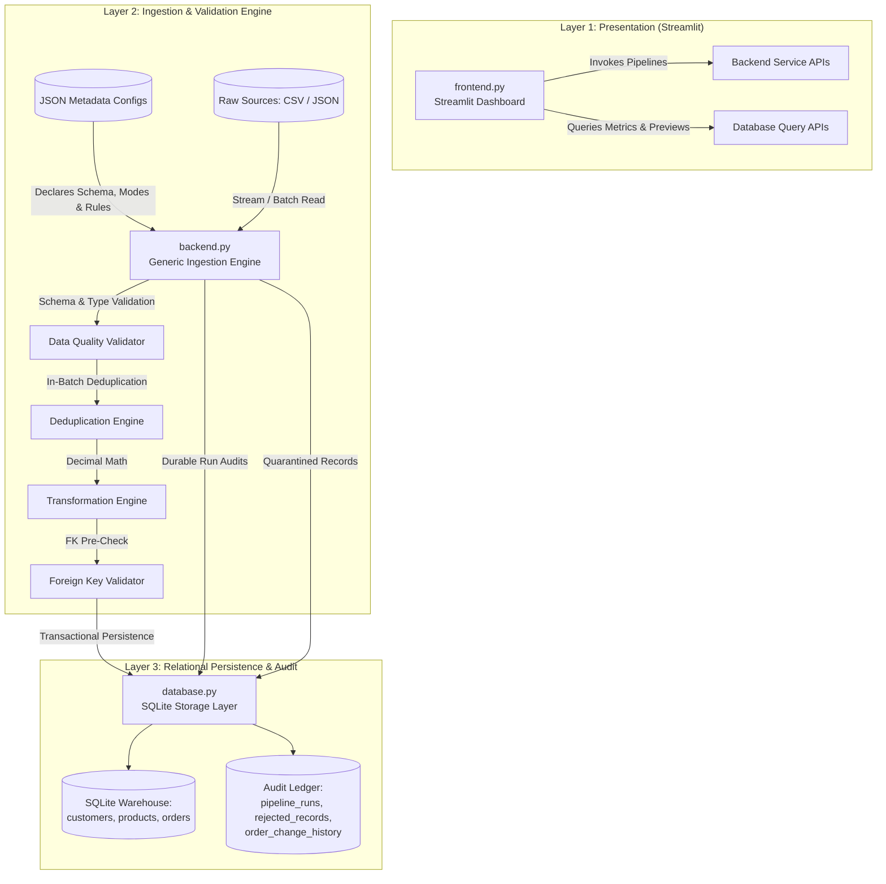
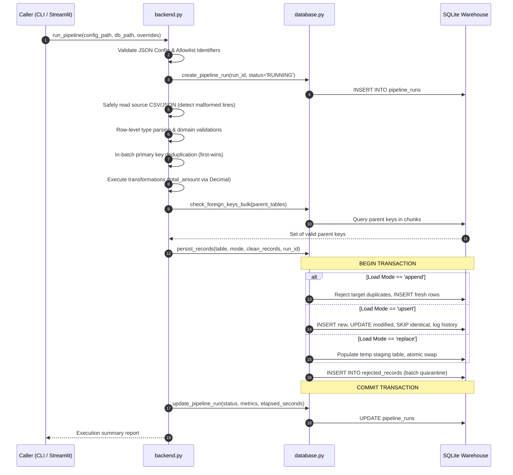

# ConfigFlow ETL – Architecture & Technical Blueprint

This document details the 3-tier architectural design, metadata-driven ingestion mechanics, transaction lifecycle, security boundary model, and failure recovery policies of the ConfigFlow ETL platform.

---

## 1. System Architecture

The ConfigFlow ETL platform is strictly decoupled into three main application layers:



---

## 2. Ingestion & Execution Lifecycle

Every ingestion execution follows a deterministic, 8-stage pipeline:



---

## 3. Core Architectural Mechanisms

### 3.1 Metadata-Driven Generic Loader
The ingestion engine contains **zero hardcoded branches** on dataset names. Whether processing `customers`, `products`, or `orders`, the engine dynamically consumes:
- Source specification: file format (`csv` / `json`), relative paths, options.
- Schema definition: column types (`string`, `integer`, `decimal`, `boolean`, `timestamp`), nullability.
- Primary and foreign key configurations: source column, parent table, parent column.
- Validation rules: minimum values, regex pattern matching, required non-nullable fields.
- Transformations: metadata-driven mathematical expressions using precise `Decimal` calculation.

### 3.2 SQL Identifier Validation & Parameterization
To prevent SQL injection vulnerabilities:
1. **Identifier Allowlist & Regex:** Every table name is validated against an allowed set (`ALLOWED_TABLES`) and checked with regex `^[a-zA-Z_][a-zA-Z0-9_]*$`.
2. **Quoted Identifiers:** All validated table and column names are quoted (e.g. `"{column}"`).
3. **Strict Parameterization:** No values are ever concatenated into SQL strings. All queries utilize parameterized statements (`?`).

### 3.3 Transaction Management & Rollback
- Operations within a load are wrapped inside a context manager (`database.transaction`).
- On any operational failure or database constraint violation:
  1. The active transaction is immediately rolled back (`conn.rollback()`).
  2. No partial updates are left in target tables.
  3. A separate, durable transaction records the run status as `FAILED` in `pipeline_runs` along with the failure reason and elapsed time.

### 3.4 Atomic Replace Semantics
In `replace` mode, rather than truncating the target table directly (which risks leaving an empty table if incoming data is bad):
1. A temporary staging table (`"{table}_staging_{run_id}"`) is created with the identical schema.
2. Clean accepted records are inserted into the staging table.
3. Within an atomic transaction, the target table is cleared and repopulated:
   ```sql
   DELETE FROM "{table}";
   INSERT INTO "{table}" SELECT * FROM "{staging_table}";
   DROP TABLE "{staging_table}";
   ```
4. If an error occurs at any point, the transaction rolls back, leaving the previous good target table **100% intact**.

### 3.5 Rejection Tracking & Quarantine Traceability
Invalid rows never crash the pipeline unless a batch-level schema error occurs. Instead, rows are partitioned into:
- **Clean Records:** Transition forward to persistence.
- **Quarantined Records:** Written to `rejected_records` with:
  - `run_id`: Lineage to the executing run.
  - `source_file`: Lineage to the originating raw file.
  - `row_number`: 1-indexed source row number.
  - `raw_payload`: Exact source line representation.
  - `reason_code`: Canonical code (`MALFORMED_ROW`, `MISSING_REQUIRED_FIELD`, `NULL_PRIMARY_KEY`, `DUPLICATE_KEY_IN_BATCH`, `DUPLICATE_KEY_TARGET`, `WRONG_DATA_TYPE`, `INVALID_CUSTOMER_FK`, `INVALID_PRODUCT_FK`, `INVALID_QUANTITY`, `NEGATIVE_PRICE`).
  - `reason_detail`: Descriptive diagnosis for debugging.

---

## 4. Mathematical Reconciliation Model

Every completed pipeline run guarantees two mathematical conservation laws:

$$\text{input\_count} = \text{accepted\_count} + \text{rejected\_count}$$

$$\text{accepted\_count} = \text{inserted\_count} + \text{updated\_count} + \text{skipped\_count}$$

These invariants are programmatically verified and monitored across all runs via `database.get_reconciliation_summary(conn)`.
