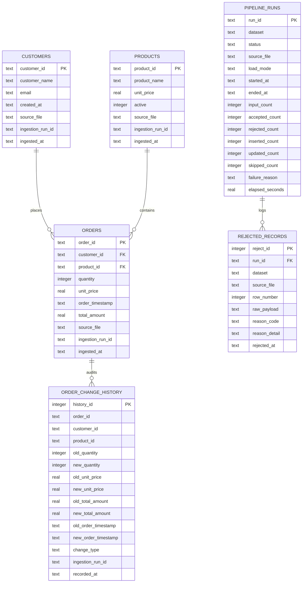

# ConfigFlow ETL – Data Dictionary & Specification

This document provides the formal data dictionary, schema constraints, domain rules, and business assumptions governing the ConfigFlow ETL platform.

---

## 1. Entity Relationship Overview

---

## 2. Table Specifications

### 2.1 `customers`
*Grain:* One record per registered customer.

| Column | Physical Type | Logical Type | Nullable | Constraint | Description |
| :--- | :--- | :--- | :--- | :--- | :--- |
| `customer_id` | `TEXT` | String | **No** | `PRIMARY KEY` | Unique business customer identifier (e.g. `CUST-00001`). |
| `customer_name` | `TEXT` | String | **No** | None | Full legal or commercial customer name. |
| `email` | `TEXT` | String | **Yes** | Regex format | Customer email address. Format validated by regex `^[^@\s]+@[^@\s]+\.[^@\s]+$`. |
| `created_at` | `TEXT` | ISO8601 Timestamp | **No** | Valid ISO8601 | Registration timestamp in UTC. |
| `source_file` | `TEXT` | String | **No** | None | Audit: basename of the ingestion source file. |
| `ingestion_run_id` | `TEXT` | String | **No** | None | Audit: unique run ID that populated this record. |
| `ingested_at` | `TEXT` | ISO8601 Timestamp | **No** | None | Audit: UTC timestamp when the record was written to the warehouse. |

---

### 2.2 `products`
*Grain:* One record per product SKU in the catalog.

| Column | Physical Type | Logical Type | Nullable | Constraint | Description |
| :--- | :--- | :--- | :--- | :--- | :--- |
| `product_id` | `TEXT` | String | **No** | `PRIMARY KEY` | Unique SKU identifier (e.g. `PROD-00001`). |
| `product_name` | `TEXT` | String | **No** | None | Commercial name of the product. |
| `unit_price` | `REAL` | Decimal(10,2) | **No** | `CHECK(unit_price >= 0)` | Base unit price in USD. Precision rounded to 2 decimal places. |
| `active` | `INTEGER` | Boolean | **No** | `CHECK(active IN (0, 1))` | Availability flag: `1` for active, `0` for inactive. |
| `source_file` | `TEXT` | String | **No** | None | Audit: source filename. |
| `ingestion_run_id` | `TEXT` | String | **No** | None | Audit: pipeline run ID. |
| `ingested_at` | `TEXT` | ISO8601 Timestamp | **No** | None | Audit: UTC warehouse ingestion timestamp. |

---

### 2.3 `orders`
*Grain:* One record per transactional order line item.

| Column | Physical Type | Logical Type | Nullable | Constraint | Description |
| :--- | :--- | :--- | :--- | :--- | :--- |
| `order_id` | `TEXT` | String | **No** | `PRIMARY KEY` | Unique order transaction identifier (e.g. `ORD-0000001`). |
| `customer_id` | `TEXT` | String | **No** | `REFERENCES customers(customer_id)` | Foreign key to `customers`. Enforced with `PRAGMA foreign_keys=ON`. |
| `product_id` | `TEXT` | String | **No** | `REFERENCES products(product_id)` | Foreign key to `products`. Enforced with `PRAGMA foreign_keys=ON`. |
| `quantity` | `INTEGER` | Integer | **No** | `CHECK(quantity > 0)` | Number of units purchased. Must be strictly positive integer. |
| `unit_price` | `REAL` | Decimal(10,2) | **No** | `CHECK(unit_price >= 0)` | Price per unit at purchase time in USD. |
| `order_timestamp` | `TEXT` | ISO8601 Timestamp | **No** | Valid ISO8601 | Event timestamp when order occurred. |
| `total_amount` | `REAL` | Decimal(12,2) | **No** | `CHECK(total_amount >= 0)` | Derived column: calculated as `quantity * unit_price` using Python `Decimal` with `ROUND_HALF_UP` to prevent floating-point drift. |
| `source_file` | `TEXT` | String | **No** | None | Audit: source filename. |
| `ingestion_run_id` | `TEXT` | String | **No** | None | Audit: pipeline run ID. |
| `ingested_at` | `TEXT` | ISO8601 Timestamp | **No** | None | Audit: UTC warehouse ingestion timestamp. |

---

### 2.4 `order_change_history`
*Grain:* One record per modification, late-arrival, or replacement event for an order.

| Column | Physical Type | Logical Type | Nullable | Constraint | Description |
| :--- | :--- | :--- | :--- | :--- | :--- |
| `history_id` | `INTEGER` | Integer | **No** | `PRIMARY KEY AUTOINCREMENT` | Auto-incrementing surrogate audit identifier. |
| `order_id` | `TEXT` | String | **No** | None | Order identifier experiencing the change. |
| `customer_id` | `TEXT` | String | **No** | None | Associated customer ID. |
| `product_id` | `TEXT` | String | **No** | None | Associated product ID. |
| `old_quantity` | `INTEGER` | Integer | **Yes** | None | Quantity prior to the update. |
| `new_quantity` | `INTEGER` | Integer | **Yes** | None | Incoming quantity from the source batch. |
| `old_unit_price` | `REAL` | Decimal(10,2) | **Yes** | None | Unit price prior to update. |
| `new_unit_price` | `REAL` | Decimal(10,2) | **Yes** | None | Incoming unit price from the source batch. |
| `old_total_amount` | `REAL` | Decimal(12,2) | **Yes** | None | Total amount prior to update. |
| `new_total_amount` | `REAL` | Decimal(12,2) | **Yes** | None | Incoming recalculated total amount. |
| `old_order_timestamp` | `TEXT` | ISO8601 Timestamp | **Yes** | None | Previous event timestamp. |
| `new_order_timestamp` | `TEXT` | ISO8601 Timestamp | **Yes** | None | Incoming event timestamp. |
| `change_type` | `TEXT` | String | **No** | None | Nature of change (`UPDATE`, `LATE_EVENT_RECORDED`, `REPLACE`). |
| `ingestion_run_id` | `TEXT` | String | **No** | None | Ingestion run triggering this audit record. |
| `recorded_at` | `TEXT` | ISO8601 Timestamp | **No** | None | UTC timestamp when change was committed. |

---

### 2.5 `pipeline_runs`
*Grain:* One record per execution of any dataset pipeline.

| Column | Physical Type | Nullable | Description |
| :--- | :--- | :--- | :--- |
| `run_id` | `TEXT PRIMARY KEY` | **No** | Unique run identifier (e.g. `RUN-4CDA87133332`). |
| `dataset` | `TEXT` | **No** | Target dataset name (`customers`, `products`, `orders`). |
| `status` | `TEXT` | **No** | Terminal status: `SUCCESS`, `PARTIAL_SUCCESS`, or `FAILED`. |
| `source_file` | `TEXT` | **No** | Full or relative path to the processed source file. |
| `load_mode` | `TEXT` | **No** | Ingestion load mode applied: `append`, `upsert`, or `replace`. |
| `started_at` | `TEXT` | **No** | UTC ISO8601 timestamp when run was initiated. |
| `ended_at` | `TEXT` | **Yes** | UTC ISO8601 timestamp when run completed or aborted. |
| `input_count` | `INTEGER` | **No** | Total raw rows identified in the source payload. |
| `accepted_count` | `INTEGER` | **No** | Clean records passing all schema and business validations. |
| `rejected_count` | `INTEGER` | **No** | Corrupt, malformed, or invalid records quarantined. |
| `inserted_count` | `INTEGER` | **No** | New records persisted to the target warehouse table. |
| `updated_count` | `INTEGER` | **No** | Existing records updated due to modified payload values. |
| `skipped_count` | `INTEGER` | **No** | Existing identical records or superseded late arrivals skipped. |
| `failure_reason` | `TEXT` | **Yes** | Exception stack trace or error detail for batch-level aborts. |
| `elapsed_seconds` | `REAL` | **No** | Wall-clock execution duration in seconds. |

---

### 2.6 `rejected_records`
*Grain:* One record per rejected/quarantined data row.

| Column | Physical Type | Nullable | Description |
| :--- | :--- | :--- | :--- |
| `reject_id` | `INTEGER PRIMARY KEY AUTOINCREMENT` | **No** | Surrogate key for the quarantine event. |
| `run_id` | `TEXT` | **No** | Foreign key to `pipeline_runs(run_id)`. |
| `dataset` | `TEXT` | **No** | Target dataset name. |
| `source_file` | `TEXT` | **No** | Source file where the offending row originated. |
| `row_number` | `INTEGER` | **Yes** | Source 1-indexed row or line number (if discernible). |
| `raw_payload` | `TEXT` | **No** | Exact raw string or JSON representation of the offending row. |
| `reason_code` | `TEXT` | **No** | Machine-readable error code (e.g. `INVALID_QUANTITY`, `INVALID_CUSTOMER_FK`). |
| `reason_detail` | `TEXT` | **No** | Human-readable explanation of why the row was rejected. |
| `rejected_at` | `TEXT` | **No** | UTC timestamp when quarantine occurred. |

---

## 3. Monetary Validation, Rounding, & Drift Prevention

### 3.1 Problem Statement
Floating-point binary representations (IEEE-754) exhibit precision loss during arithmetic (e.g., `0.1 + 0.2 = 0.30000000000000004` and `3 * 0.10 = 0.30000000000000004`). In financial and transactional systems, floating-point drift creates reconciliation mismatches and balance discrepancies.

### 3.2 Implemented Policy
- **Python Engine:** All monetary values (`unit_price`, `total_amount`) are parsed and computed using standard library `decimal.Decimal`.
- **Rounding Specification:** Explicit rounding mode `decimal.ROUND_HALF_UP` quantized to two decimal places:
  $$\text{total\_amount} = \text{quantize}\left(\text{Decimal}(\text{quantity}) \times \text{Decimal}(\text{unit\_price}), \text{Decimal}('0.01'), \text{ROUND\_HALF\_UP}\right)$$
- **Warehouse Storage:** Values are stored in SQLite `REAL`/`NUMERIC` fields with two-decimal precision guaranteed by the pipeline. Boundary prices of `$0.00` (e.g. promotional items) are valid; negative prices are strictly rejected.

---

## 4. Business Rules & Invariant Assumptions

1. **Dependency Ordering:** The `orders` fact table depends on foreign key references to `customers` and `products`. Parent dimension tables must be loaded prior to child fact tables.
2. **Deterministic Deduplication:** Batches containing multiple rows with the identical primary key are deduplicated according to the configured policy:
   - `first-wins` (default): The first row is retained; subsequent rows are quarantined with `DUPLICATE_KEY_IN_BATCH`.
   - `last-wins`: The latest row is retained; earlier rows are quarantined.
3. **Append Idempotency:** In `append` mode, rows whose primary key already exists in the target table are quarantined as `DUPLICATE_KEY_TARGET`. This ensures reruns of identical input batches never produce duplicate business rows.
4. **Late-Arriving Order Policy:** When an order record arrives with an event timestamp older than the current warehouse record, the warehouse target state is preserved (latest event wins), while an audit entry is durably recorded in `order_change_history` with `change_type = 'LATE_EVENT_RECORDED'`.
